# Rocket Sync — guida per il team

Questa guida è per chi usa Rocket Sync ogni giorno con OpenRocket. Non serve sapere niente di Git:
l'app se ne occupa lei.

> Gli screenshot mostrano dati di prova (progetti "Experimental Rocket", "Aurora Sounding",
> "Vega Booster"). I vostri progetti avranno nomi e persone diversi.

## Indice

1. [Che cos'è Rocket Sync](#1-che-cosè-rocket-sync)
2. [Il primo avvio](#2-il-primo-avvio)
3. [Lavorare ogni giorno con OpenRocket](#3-lavorare-ogni-giorno-con-openrocket)
4. [Le spie di stato](#4-le-spie-di-stato)
5. [Pubblicare una versione](#5-pubblicare-una-versione)
6. [Ricevere gli aggiornamenti dei colleghi](#6-ricevere-gli-aggiornamenti-dei-colleghi)
7. ["Hai riaperto il file dopo l'aggiornamento?"](#7-hai-riaperto-il-file-dopo-laggiornamento)
8. [Conflitti: cosa fare](#8-conflitti-cosa-fare)
9. [Version History](#9-version-history)
10. [Notes & Tasks](#10-notes--tasks)
11. [Notifiche e Discord](#11-notifiche-e-discord)
12. [Membri e ruoli](#12-membri-e-ruoli)
13. [Senza connessione](#13-senza-connessione)
14. [Domande frequenti](#14-domande-frequenti)

---

## 1. Che cos'è Rocket Sync

Rocket Sync tiene in ordine i file OpenRocket (`.ork`) di tutto il team. Ogni volta che pubblicate,
nasce una **versione** numerata: la vedono tutti, si può riaprire, confrontare e ripristinare.
Nessuno cancella il lavoro di un altro, e niente va perso.

Rocket Sync lavora sulla **cartella del progetto**, sul vostro PC. Voi salvate i file con OpenRocket
nella cartella, come sempre. Il resto lo fa l'app.

## 2. Il primo avvio

Al primo avvio l'app vi guida in otto passi.

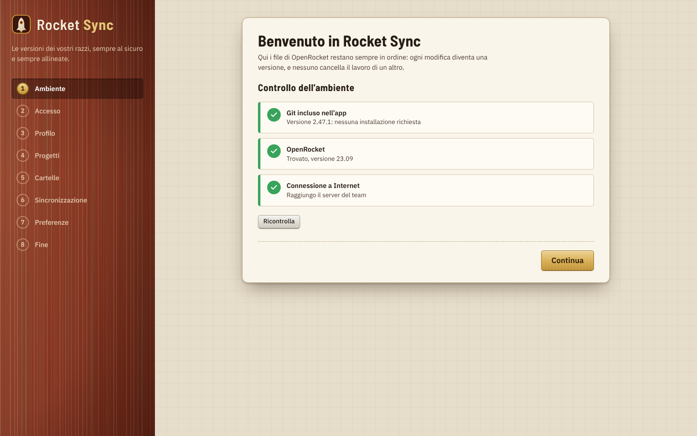

1. **Ambiente.** L'app controlla che tutto sia pronto. Se OpenRocket non viene trovato potete
   continuare: vi servirà solo per aprire i file dall'app.
2. **Accesso.** Premete **Accedi con GitHub** e completate l'accesso nel browser. Usate sempre lo
   stesso account. L'app non vede mai la vostra password.
3. **Profilo.** Scegliete il nome che comparirà accanto alle vostre versioni e un colore.
4. **Progetti.** Selezionate i progetti su cui lavorerete da questo PC. Se manca il vostro, un
   amministratore deve invitarvi con il vostro username GitHub.
5. **Cartelle.** Per ogni progetto scegliete dove tenere i file.
   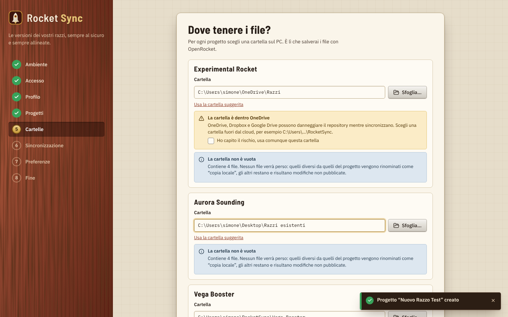
   - Consigliato: la cartella proposta, dentro `C:\Users\<voi>\RocketSync`.
   - **Evitate OneDrive, Dropbox e Google Drive.** Mentre sincronizzano possono rovinare la cartella.
     L'app vi avvisa e vi chiede una conferma.
   - Se la cartella **non è vuota** non succede niente di grave: i vostri file restano. Se un file
     ha lo stesso nome di uno del progetto ma contenuto diverso, il vostro viene rinominato in
     `nome (copia locale AAAA-MM-GG).ork`.
6. **Sincronizzazione.** L'app scarica lo storico e prepara i file. Può richiedere qualche minuto.
7. **Preferenze.** Avvio con Windows, notifiche e quando creare le versioni. Le impostazioni
   consigliate vanno bene. Si cambiano quando volete.
8. **Fine.** Si apre la Dashboard.

## 3. Lavorare ogni giorno con OpenRocket

Lavorate **come sempre**: aprite il file dalla cartella del progetto, modificate, salvate.

Quando salvate succede questo:

- Rocket Sync se ne accorge e aspetta qualche secondo che OpenRocket abbia **finito di scrivere**.
- Controlla che il file sia **completo e leggibile**. Un file a metà non entra mai in una versione.
- Il progetto passa a **"Modifiche non pubblicate"**. I colleghi non vedono ancora niente.

Una versione **non nasce a ogni salvataggio**. Nasce quando pubblicate (vedi sotto). Potete salvare
cento volte e pubblicare una volta sola.

L'app resta nella barra delle applicazioni di Windows, vicino all'orologio. Anche con la finestra
chiusa continua a controllare le novità ogni minuto.

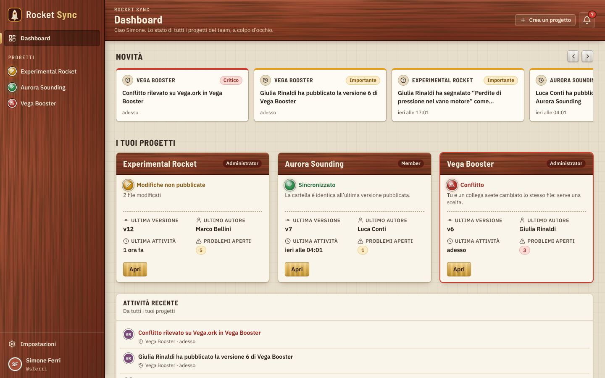

La **Dashboard** mostra tutti i vostri progetti: spia di stato, ultima versione, ultimo autore,
ultima attività e problemi aperti. In alto scorre la striscia **Novità**. La **campanella** conta le
notifiche non lette.

## 4. Le spie di stato

Ogni progetto ha una spia, sempre con un'icona e un testo. Non conta solo il colore.

| Spia | Cosa significa | Cosa fare |
|---|---|---|
| **Sincronizzato** (verde) | La vostra cartella è uguale all'ultima versione pubblicata. | Niente. |
| **Modifiche non pubblicate** (ambra) | Avete salvato modifiche che i colleghi non vedono. | Pubblicate, quando siete pronti. |
| **Pubblicazione in corso** | L'app sta creando e inviando la versione. | Aspettate qualche secondo. |
| **Aggiornamento disponibile** (ambra) | Un collega ha pubblicato una versione nuova. | Di solito parte da sola. Se non parte, leggete il motivo nella Panoramica. |
| **Aggiornamento in corso** | L'app sta scaricando le novità. | Aspettate. |
| **Conflitto** (rosso) | Voi e un collega avete cambiato lo stesso file. | Risolvete il conflitto, vedi [capitolo 8](#8-conflitti-cosa-fare). |
| **Offline** (grigio-blu) | Niente connessione. Le versioni create restano in attesa. | Continuate a lavorare, vedi [capitolo 13](#13-senza-connessione). |
| **Errore** (rosso) | Qualcosa non ha funzionato. | Leggete il messaggio e premete Riprova. |
| **Non collegato** | Il progetto non è ancora su questo PC. | Premete **Collega a una cartella**. |

## 5. Pubblicare una versione

Aprite il progetto e restate sulla **Panoramica**. Se avete salvato qualcosa, compare il riquadro
**Modifiche non pubblicate**.

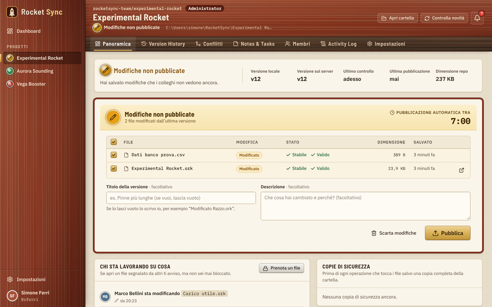

- In alto vedete il **conto alla rovescia**. Se il progetto usa la pubblicazione assistita, la
  versione parte da sola dopo 10 minuti senza nuovi salvataggi.
- La tabella elenca i **file modificati**. Ogni file mostra se è **stabile** (OpenRocket ha finito di
  scrivere) e **valido** (si può leggere). Se un file è "in salvataggio" o "non leggibile", aspettate
  o salvate di nuovo.
- Togliendo la spunta a un file, quello non entra nella versione.
- Premete **Pubblica**. Dopo pochi secondi compare un avviso con il numero della versione.

### Come scrivere un titolo e una descrizione utili

Il titolo e la descrizione sono facoltativi, ma servono a voi e ai colleghi. Se lasciate vuoto il titolo, l'app scrive qualcosa come "Modificato Razzo.ork".
Ma tra tre mesi quel titolo non vi dirà niente. Meglio scrivere **cosa avete cambiato e perché**.

| Poco utile | Meglio |
|---|---|
| `modifiche` | `Pinne più lunghe` |
| `versione nuova` | `Paracadute più grande: atterraggio troppo veloce` |
| `prova` | `Prova con quattro pinne (peggiora l'apogeo)` |

Nella descrizione aggiungete il motivo, i dati che avete usato, i dubbi aperti. Il **changelog**
(l'elenco di cosa è cambiato davvero, parametro per parametro) lo scrive l'app da sola.

### Pubblicare e basta?

Sì. Se un collega ha pubblicato nel frattempo su file diversi dai vostri, l'app unisce tutto da sola
e assegna il numero giusto. Se avete cambiato **lo stesso file**, nasce un conflitto: vedi capitolo 8.

## 6. Ricevere gli aggiornamenti dei colleghi

Quando un collega pubblica, l'app lo scopre in pochi secondi. Se **non avete modifiche su quei file** e
i file **non sono aperti in OpenRocket**, l'aggiornamento è automatico: compare un avviso tipo
"Aggiornato alla versione 13".

### Perché a volte bisogna chiudere il file in OpenRocket

OpenRocket non si accorge se un file cambia mentre è aperto. Se l'app sostituisse il file sotto i
suoi piedi, al vostro prossimo salvataggio OpenRocket riscriverebbe la **vecchia copia** e
cancellerebbe il lavoro del collega, senza che nessuno se ne accorga.

Per questo l'app **non tocca i file aperti**. Nella Panoramica vedete:

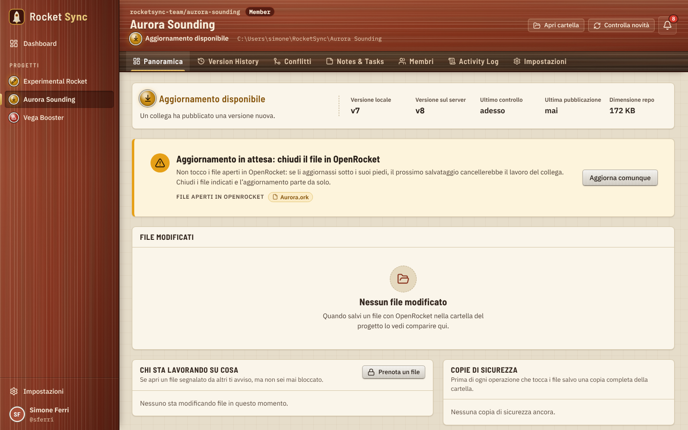

> **Aggiornamento in attesa: chiudi il file in OpenRocket.**

Chiudete il file (o OpenRocket): l'aggiornamento parte da solo.

**Aggiorna comunque** sostituisce i file subito. Usatelo solo se sapete cosa fate. Dopo l'aggiornamento
**chiudete e riaprite il file** prima di modificarlo (vedi capitolo 7).

## 7. "Hai riaperto il file dopo l'aggiornamento?"

Se avete usato **Aggiorna comunque** e poi avete salvato, l'app non può sapere se OpenRocket
partiva dalla copia nuova o da quella vecchia. Per sicurezza non pubblica e vi chiede:

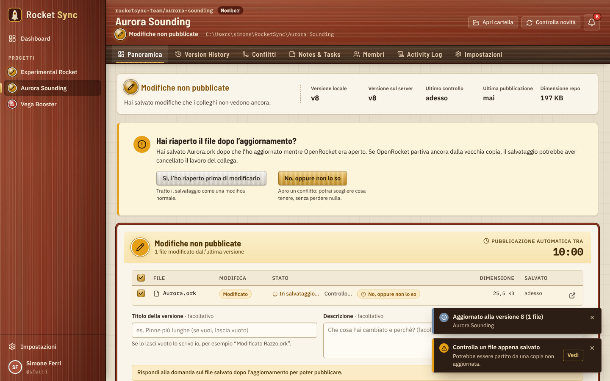

- **Sì, l'ho riaperto prima di modificarlo.** Il salvataggio è una modifica normale.
- **No, oppure non lo so.** L'app apre un **conflitto**, così potete scegliere cosa tenere senza
  cancellare il lavoro del collega.

Nel dubbio rispondete "non lo so": al peggio dedicate due minuti al conflitto.

## 8. Conflitti: cosa fare

Un conflitto nasce quando voi e un collega **cambiate lo stesso file** prima di pubblicare. Non è un
errore e non avete perso niente.

Subito succede questo:

- La vostra versione viene **messa al sicuro**, anche su GitHub.
- I file nella vostra cartella **non vengono toccati**.
- Tutto il team riceve una notifica, e **si ferma la pubblicazione** su quel progetto finché non scegliete.

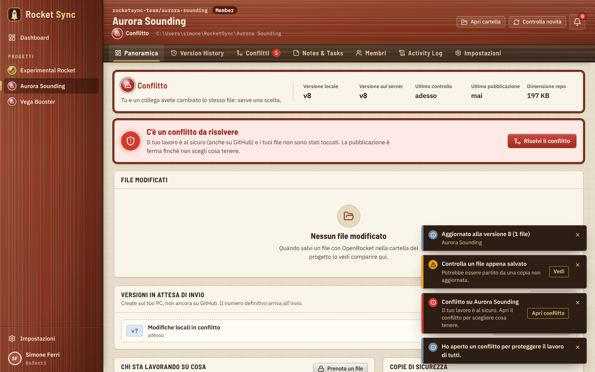

Aprite **Risolvi il conflitto**. La schermata mostra tre colonne: **di partenza** (com'era prima), **la
mia** e **la sua**. Le righe rosse sono dove vi siete **sovrapposti** (stesso componente o parametro
cambiato da entrambi). Le altre sono modifiche indipendenti.

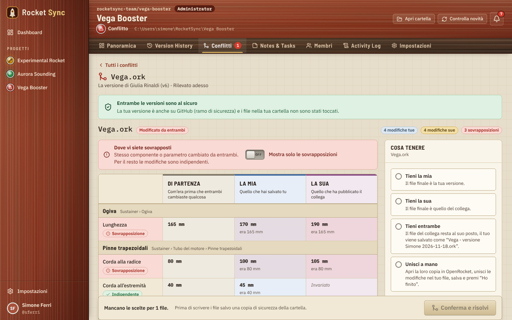

Per ogni file scegliete una delle quattro opzioni:

| Scelta | Cosa succede | Esempio |
|---|---|---|
| **Tieni la mia** | Resta la vostra versione del file. Quella del collega rimane nello storico. | Avete lavorato tutto il giorno sulle pinne e quelle del collega erano una prova. |
| **Tieni la sua** | Resta la versione del collega. La vostra rimane nello storico. | Il collega ha già corretto la stessa cosa meglio di voi. |
| **Tieni entrambe** | Due file separati: il suo resta col nome originale, il vostro diventa `Razzo - versione Simone 2026-11-18.ork`. | Non sapete quale sia meglio e volete confrontarle con calma in OpenRocket. |
| **Unisci a mano** | Aprite la copia del collega in OpenRocket (**Apri la loro copia in OpenRocket**), riportate nel vostro file le modifiche che vi servono, salvate e premete **Ho finito di unire**. | Lui ha cambiato le pinne e voi il paracadute: volete tutte e due le cose. |

Alcune note utili:

- Le righe **Indipendente** (verdi) sono cambiamenti che non si pestano i piedi. Rocket Sync, per
  prudenza, **non unisce i file `.ork` da solo**: un file che OpenRocket non riesce più a riaprire è
  peggio di un conflitto. Per tenere tutte e due le cose usate **Unisci a mano**.
- Alla fine vi viene chiesta una conferma. Nasce una versione di tipo **Risoluzione conflitto** e le
  due storie restano nello storico per sempre.
- Prima di scrivere i file, l'app fa una **copia di sicurezza** della cartella.

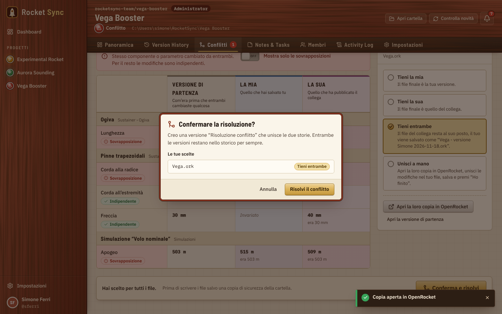

## 9. Version History

La scheda **Version History** è la storia del progetto: una carta per versione, dalla più recente.
Ogni carta mostra numero, autore, data, titolo e file. I badge indicano i **Ripristini**, le
**Risoluzioni conflitto** e le versioni **In attesa**.

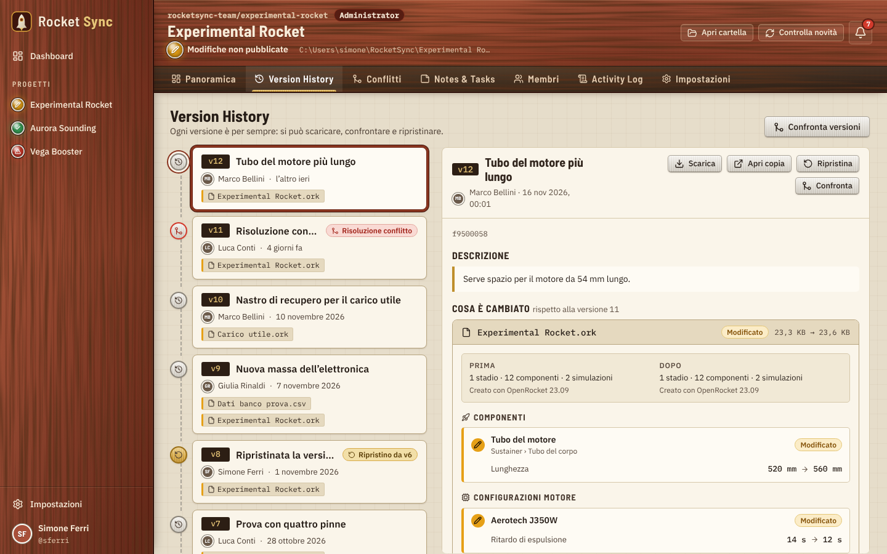

A destra vedete **cosa è cambiato** rispetto alla versione precedente:

- **Componenti**: aggiunti, rimossi, modificati, con il valore di prima e di dopo (per esempio
  "Corda alla radice 80 mm → 95 mm").
- **Configurazioni motore** e **Simulazioni** (apogeo, velocità massima…).
- **Modifiche non interpretate**: parti del file che Rocket Sync non sa descrivere con certezza.
  Lo dice chiaramente, invece di fingere di aver capito.

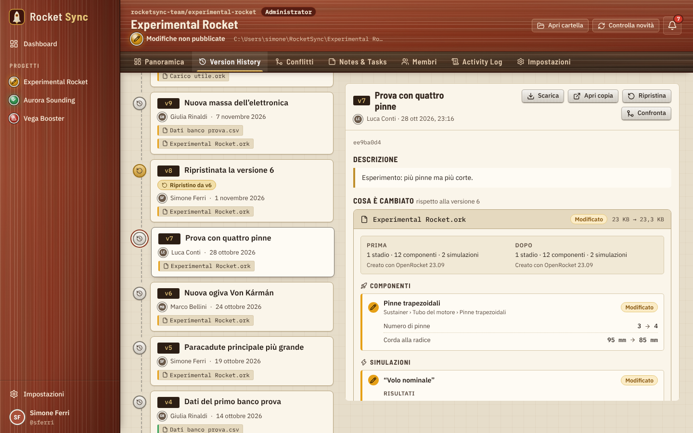

### Confrontare due versioni

Premete **Confronta versioni** e scegliete due versioni qualsiasi: vedrete le differenze tra le due,
non solo con la precedente.

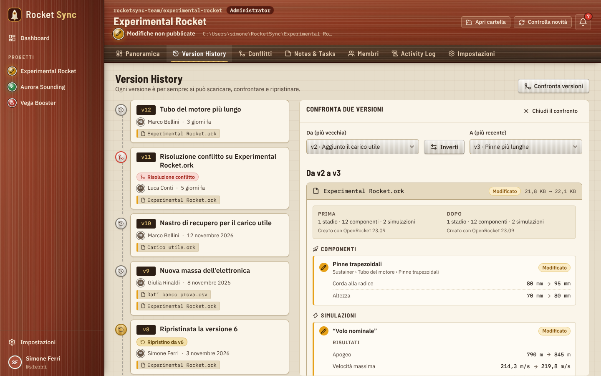

### Scaricare e aprire una copia

- **Scarica** scrive i file di quella versione in una cartella a vostra scelta.
- **Apri copia** apre una copia temporanea in OpenRocket.

In tutti e due i casi **la cartella di lavoro non viene toccata**.

### Ripristinare una versione

**Ripristina** riporta i file a com'erano in quella versione, per tutto il progetto o per un solo file.

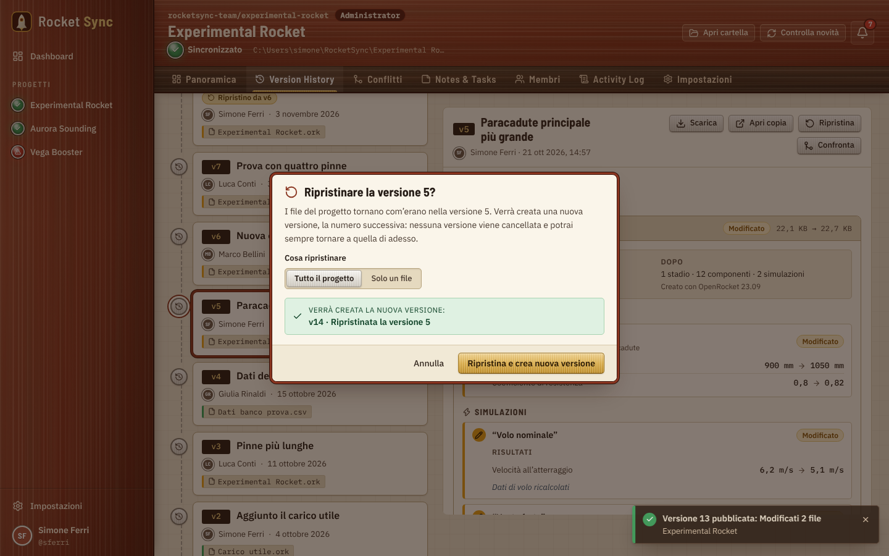

**Il ripristino non cancella niente.** Crea una **nuova versione** (la numero successiva) con il
contenuto di quella vecchia. La versione di adesso resta nello storico e potete sempre tornarci.

Prima di ripristinare dovete pubblicare o scartare le modifiche non pubblicate sui file interessati, e
non ci devono essere conflitti aperti.

## 10. Notes & Tasks

La scheda **Notes & Tasks** serve per appunti e cose da fare del progetto.

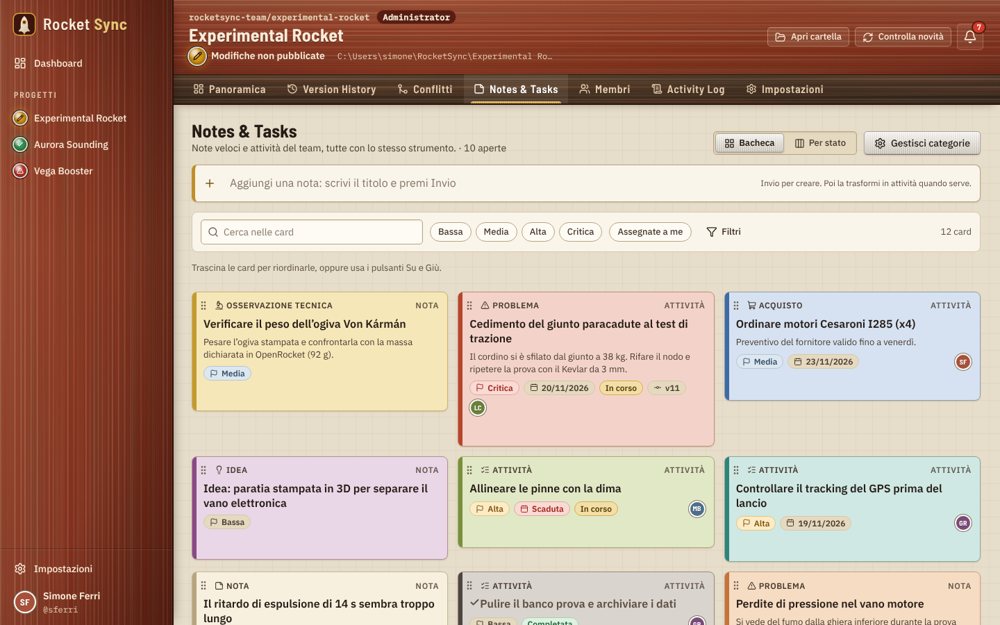

- **Nota veloce.** Scrivete il titolo in alto e premete **Invio**: la card è creata. Il titolo è l'unico
  campo obbligatorio.
- **Da nota ad attività.** Aprite la card e premete **Trasforma in attività**: compaiono
  **assegnatario, scadenza, priorità e stato**.

  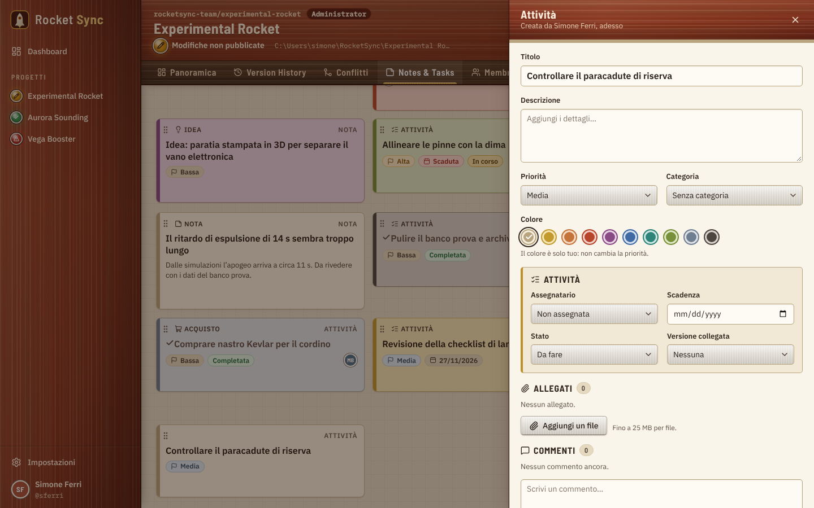

- **Colore e priorità sono indipendenti.** Il colore lo scegliete voi per riconoscere le card a
  colpo d'occhio (una palette di 10 colori da officina). La priorità (bassa, media, alta, critica)
  dice quanto è urgente. Una card gialla può essere critica, una rossa può essere bassa.
- **Categorie**: Nota, Problema, Attività, Acquisto, Idea, Osservazione tecnica. Potete aggiungerne
  altre da **Gestisci categorie**.
- **Due viste**: **Bacheca** (libera, si riordina trascinando) e **Per stato** (colonne Da fare, In
  corso, Completate).

  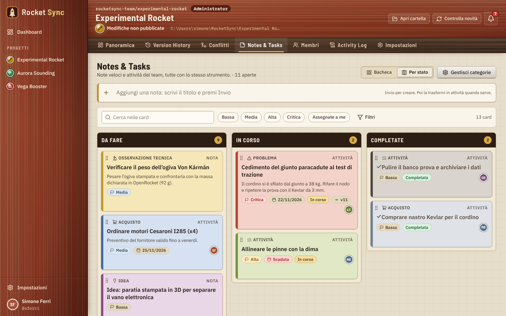

- **Filtri** per priorità, colore, categoria, assegnatario, stato e scadenza.

  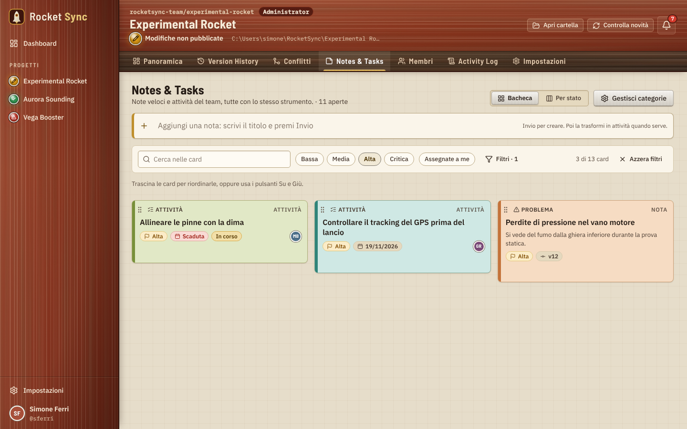

- Dentro ogni card ci sono **commenti** e **allegati** (fino a 25 MB).
- Una card con **priorità alta o critica**, o nella categoria **Problema**, avvisa tutto il team.
- Senza connessione le note restano visibili ma **solo in lettura**.

## 11. Notifiche e Discord

### Nell'app

La **campanella** in alto a destra conta le notifiche non lette. Aprendola vedete lo storico, con
filtro per progetto e **Segna tutte come lette**.

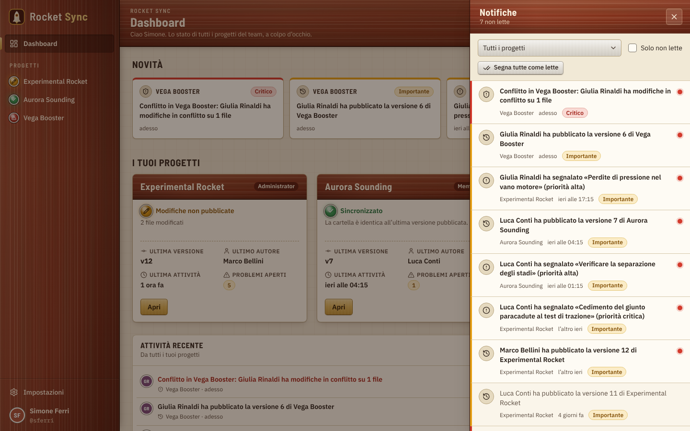

Ricevete notifiche quando:

- un collega **pubblica o ripristina** una versione;
- c'è un **conflitto** (rilevato o risolto);
- cambiano i **membri** del progetto;
- una card diventa **importante** (priorità alta o critica, o categoria Problema);
- vi **assegnano una card** (questa la vedete solo voi).

Non ricevete notifica per ciò che fate voi.

In **Impostazioni** scegliete, per ogni tipo di evento, se volete la notifica nell'app e/o quella di Windows.

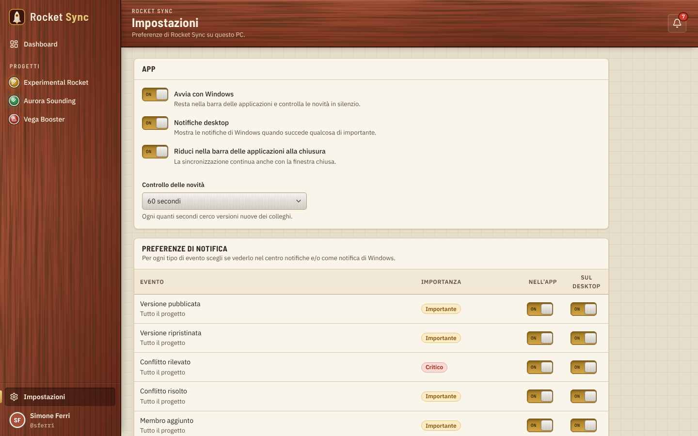

### Il diario del progetto

**Activity Log** è il diario: chi ha fatto cosa e quando, con filtri per utente, data e tipo. Gli
eventi hanno tre livelli: **Informativo**, **Importante**, **Critico**.

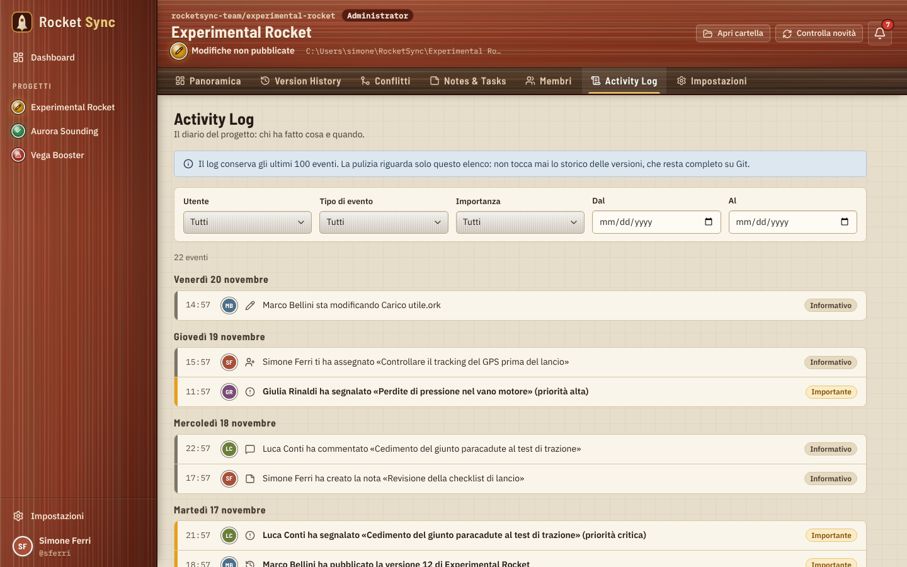

Il log tiene gli ultimi eventi (di solito 100). Quando i vecchi spariscono dall'elenco, **non
succede niente alla Version History**: le versioni restano tutte.

### Discord

Un amministratore può collegare un canale Discord da **Impostazioni del progetto → Discord**:
incolla l'indirizzo del webhook, sceglie gli eventi da inviare e prova con **Invia messaggio di prova**.
I messaggi sono in italiano, con l'ora di Roma. Una raffica di eventi in due minuti diventa un solo
messaggio. L'indirizzo del webhook non si può più rileggere: se serve cambiarlo, se ne inserisce uno nuovo.

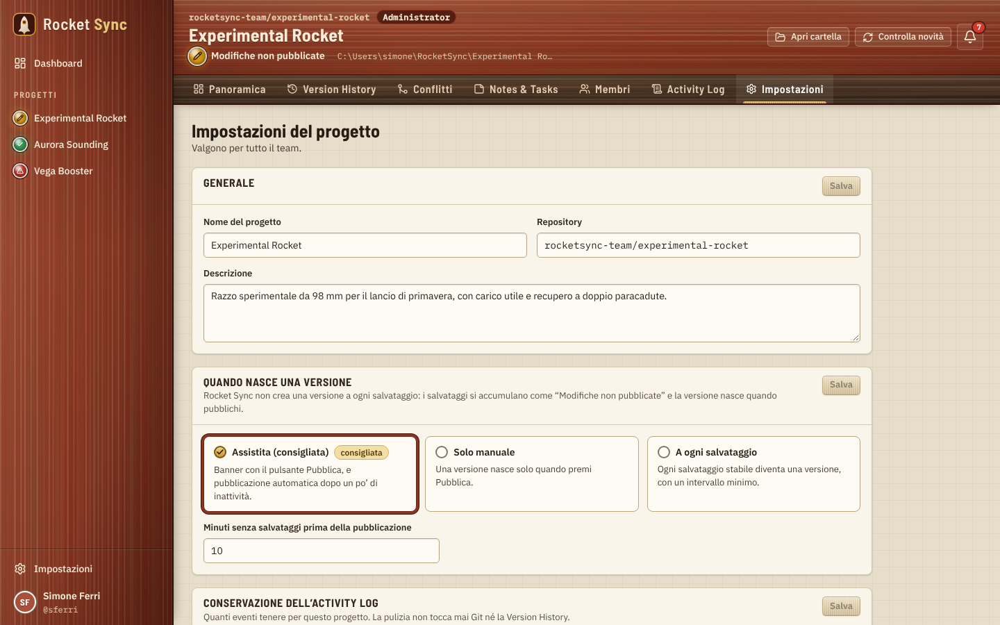

## 12. Membri e ruoli

La scheda **Membri** mostra chi lavora al progetto e quando è stato attivo l'ultima volta.

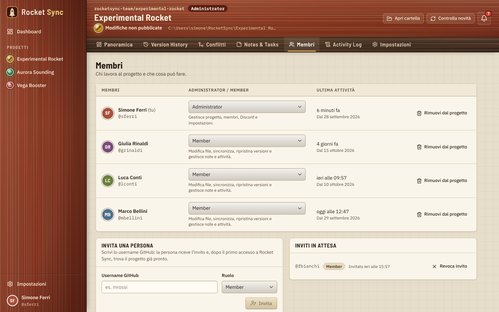

| Ruolo | Cosa può fare |
|---|---|
| **Administrator** | Tutto quello che fa un Member, più: invitare e rimuovere persone, cambiare i ruoli, configurare Discord, decidere come nascono le versioni e quanti eventi tiene l'Activity Log. |
| **Member** | Modificare i file, sincronizzare, pubblicare e ripristinare versioni, usare Notes & Tasks. |

Ogni progetto ha **sempre almeno un amministratore**: l'ultimo non si può rimuovere né declassare.

**Invitare una persona**: un amministratore scrive il suo **username GitHub** e sceglie il ruolo. Dopo il
primo accesso a Rocket Sync la persona trova il progetto già pronto.

Un Member vede le stesse schermate, ma le azioni riservate agli amministratori sono disabilitate e
spiegate.

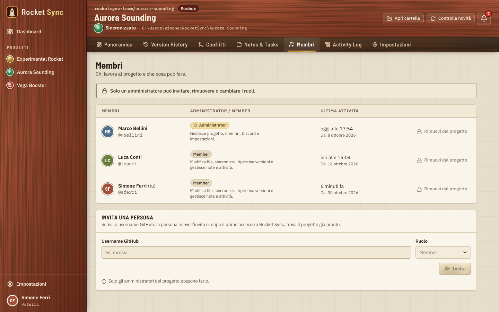

## 13. Senza connessione

Se la connessione manca, **continuate a lavorare normalmente**. In alto compare l'avviso "Sei offline".

- Quando premete **Pubblica**, la versione viene creata **sul vostro PC** e resta **in attesa di invio**.
  Non ha ancora il suo numero definitivo.
- Appena torna la connessione l'app invia le versioni in attesa, **ricalcola i numeri** (nel frattempo
  i colleghi potrebbero aver pubblicato) e avvisa tutti.
- Se in attesa ci sono più versioni, vengono inviate nell'ordine in cui le avete create.
- Le note restano in sola lettura.

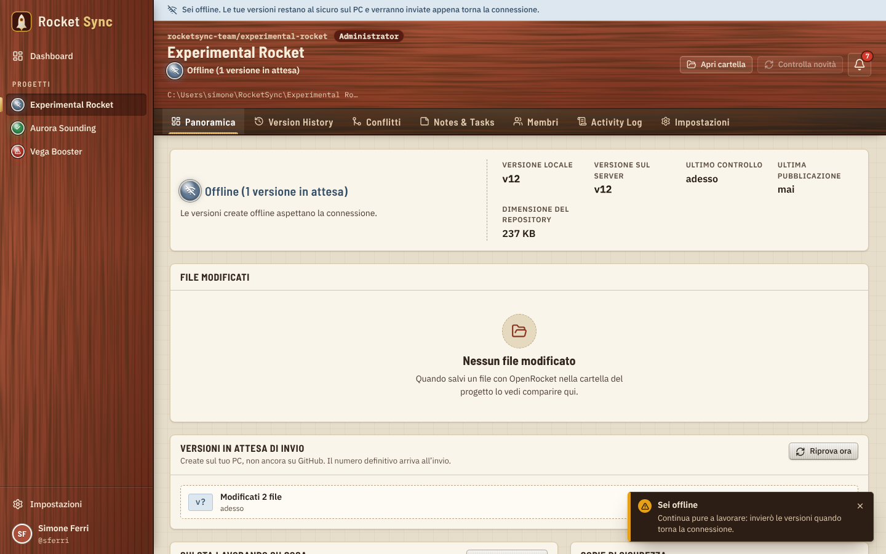

Se lo stesso file è stato cambiato anche da un collega, al ritorno della connessione nasce un
conflitto: si risolve come al capitolo 8.

## 14. Domande frequenti

**Ho perso il mio lavoro?**
Quasi certamente no. L'app non cancella mai niente:

- **Ogni versione resta nello storico** per sempre. Anche quelle "sostituite" da un ripristino o da un conflitto.
- **Copie di sicurezza.** Prima di ogni operazione che tocca i file (pubblicare, aggiornare,
  ripristinare, scartare, risolvere un conflitto) l'app salva una **copia completa della cartella**.
  Le trovate nella **Panoramica**, in basso, nel riquadro **Copie di sicurezza**: con **Esporta**
  scegliete una cartella dove ritrovare i file. Si conservano 30 giorni, fino a 50 per progetto.
- **Conflitti.** La vostra versione è anche su GitHub, e le copie dei file in conflitto sono in
  `.rocketsync\local\conflitti` dentro la cartella del progetto.

**Ho premuto "Scarta modifiche" per sbaglio.**
Prima di scartare, l'app fa una copia di sicurezza. Esportatela dal riquadro **Copie di sicurezza**.

**Ho modificato un file ma non succede niente.**
Controllate che l'abbiate salvato **dentro la cartella del progetto** (la trovate scritta sotto il
nome del progetto, e con **Apri cartella**). Se il file è "in salvataggio" o "non leggibile", salvate di nuovo.

**Il file non si può pubblicare ("non leggibile").**
Era incompleto o rovinato. Salvatelo di nuovo da OpenRocket. Se continua, ripristinate il file da
una versione precedente.

**Cosa vuol dire "Aggiornamento in attesa"?**
Un file da aggiornare è aperto in OpenRocket. Chiudetelo: l'aggiornamento parte da solo.

**Posso lavorare in due su un progetto?**
Sì. Se cambiate file diversi, non succede niente di speciale. Nella Panoramica, **Chi sta lavorando su
cosa** mostra chi sta modificando quale file e permette di **prenotare** un file con una nota. Se
aprite un file prenotato da altri vi arriva un avviso, ma **non siete mai bloccati**.

**Posso spostare la cartella del progetto?**
Meglio non farlo a mano. Se serve, andate in **Impostazioni del progetto → Scollega da questo PC**
(i file restano dove sono) e poi ricollegate il progetto scegliendo la nuova cartella. Evitate sempre
OneDrive, Dropbox e Google Drive.

**Quanto è grande il progetto?**
Nella Panoramica c'è la **dimensione**. Ogni versione di un file `.ork` si salva per intero:
salvare in OpenRocket solo i dati principali delle simulazioni aiuta a tenere tutto leggero. Sopra 50
MB per file l'app avvisa, oltre 100 MB non è possibile pubblicare.

**La pubblicazione automatica mi dà fastidio.**
Un amministratore può cambiare la regola in **Impostazioni del progetto → Quando nasce una versione**:
*Assistita* (consigliata), *Solo manuale* oppure *A ogni salvataggio*.

**Come mando un problema a chi mi aiuta?**
In **Impostazioni → Diagnostica → Esporta diagnostica**: crea un file con i dati tecnici, senza
password né token.

**Come mi disconnetto?**
In **Impostazioni → Account → Esci**. I file nelle cartelle restano dove sono.
